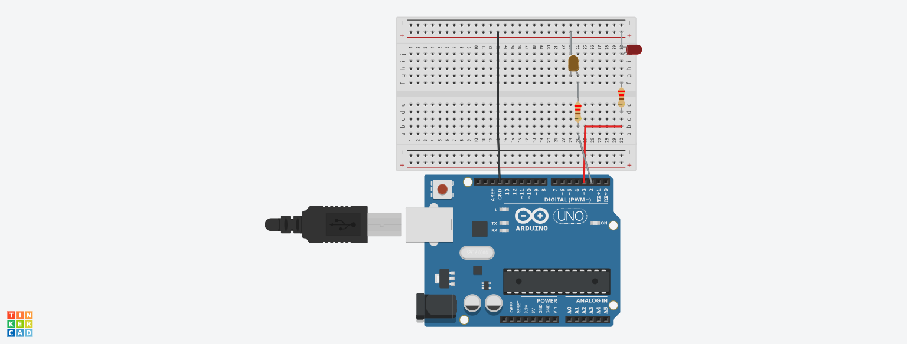
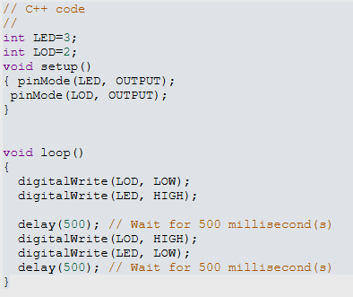
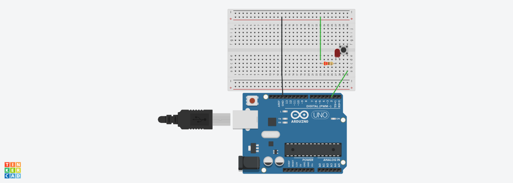
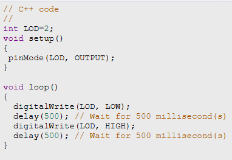
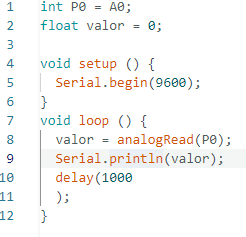
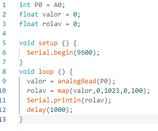
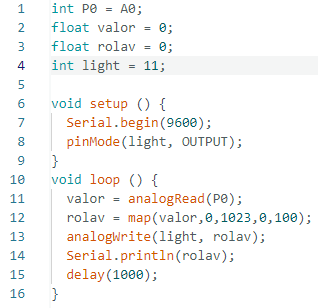

# Encendido de ledes alternativo💡🔁💡
En esta práctica montamos un circuito básico en el que conectamos a la placa base, a una fuente de energía, y al mismo tiempo a una placa de prototipado. Esta placa de prototipado tiene conectadas dos resistencias de 220 ohms y dos ledes de colores (preferiblemente de distintos colores).

Imágen del circuito

El objetivo de esta práctica es conseguir que estos dos ledes parpadeen alternativamente, es decir, uno se enciende, se apaga, se enciende el otro, se apaga el otro, se enciende este... Así en bucle, la forma en la que se consigue esto es programando la placa de arduino.
Yo he usado este código

Imágen del código

# Pulsador🛎️
En esta práctica tenemos un diodo led apagado, una resistencia y un pulsador (la placa arduino y de prototipado se asumen de aquí en adelante).

Imágen del circuito

Esta práctica radica en que cuando pulses el botón el led parpadee y cuando no, se quede apagado.
Para conseguir este propósito debes conectar el circuito de la forma indicada arriba y programar este código.

Imágen del código

Al hacer esto el led no recibirá energía excepto mientras este el botón pulsado lo que hará que la reciba a intervalos y que parpadee.

# Potenciómetro motor serie🎛️🖥️
En esta práctica debemos hacer aparecer distintos valores del 0 al 1023 en el monitor serie según un potenciómetro usando este código

# Mapeado de datos del potenciómetro🗺️🎛️
En esta práctica el objetivo es traducir los valores de 0/1023 a 0/100 con la función de mapeado.

# PMW💡🎛️
Para esta práctica hay que hacer lo mismo que en la anterior pero usando el analogWrite para que según el valor el led brille más o menos

